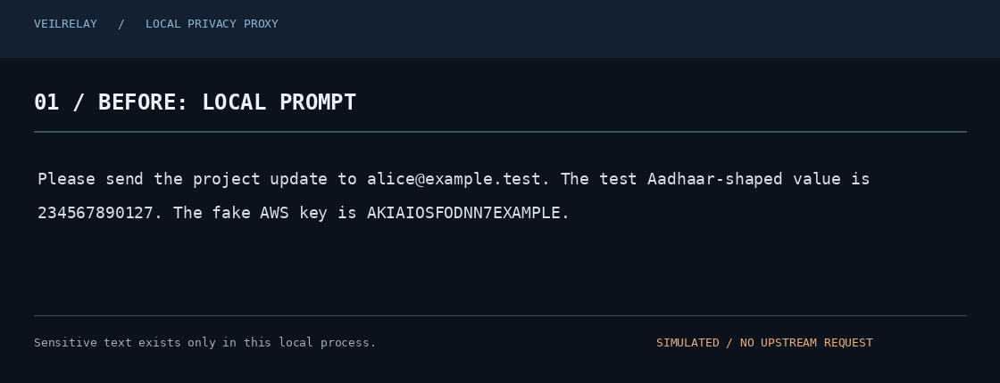

# VeilRelay

**A self-hosted privacy proxy that replaces detected PII and credentials before OpenAI-compatible prompts leave your machine.**



VeilRelay runs locally between your application and an OpenAI-compatible upstream. It scans supported text, replaces detected values with reversible typed placeholders, and restores known placeholders in normal and streamed responses. It is MIT-licensed, has no hosted tier or accounts, and sends no telemetry.

> **Security boundary:** This reduces accidental disclosure of recognized patterns. Detection is incomplete; it does not stop deliberate obfuscation, protect a compromised host, or control provider-side handling. Do not treat it as a compliance control or a guarantee that prompts contain no sensitive data. Read [the threat model](docs/THREAT_MODEL.md).

## Benchmark snapshot

The table below is regenerated from the committed raw output by `python bench/update_readme.py`.

<!-- BENCHMARK-SUMMARY:START -->
| Detector | Micro precision / recall / F1 | Gold spans | Run status |
|---|---:|---:|---|
| VeilRelay | 1.000 / 1.000 / 1.000 | 26 | completed |
| Plain regex | 0.733 / 0.423 / 0.537 | 26 | completed |
| Presidio defaults | — | — | skipped (ModuleNotFoundError) |

- **Dataset:** synthetic: 24 rows (completed), ai4privacy-openpii-nano-validation: 0 rows (not_downloaded).
- **Added local detector latency:** p50 0.020040 ms; p95 0.041111 ms (240 paired samples; plain-regex baseline).
- **Utility preservation:** skipped — OLLAMA_MODEL is not configured.
- **Presidio:** Presidio defaults were skipped (ModuleNotFoundError); no metrics are inferred.
- **Interpretation:** the current run is a small synthetic regression smoke test, not a real-world accuracy estimate. Exact spans use `(start, end, type)`. See [methodology](bench/METHODOLOGY.md), [raw CSV](bench/results/detection_metrics.csv), [latency JSON](bench/results/latency.json), and [run summary](bench/results/summary.json).
<!-- BENCHMARK-SUMMARY:END -->

## Quickstart

From a clone, run these three commands in the repository root:

```bash
python -m pip install .
export UPSTREAM_BASE_URL=https://api.openai.com/v1
veil serve
```

Use the OpenAI Python SDK with a one-line base URL change:

```python
from openai import OpenAI

client = OpenAI(
    api_key="YOUR_PROVIDER_API_KEY",
    base_url="http://127.0.0.1:8080/v1",
)

response = client.chat.completions.create(
    model="gpt-4o-mini",
    messages=[{"role": "user", "content": "Summarize this text..."}],
    stream=True,
)
for chunk in response:
    print(chunk.choices[0].delta.content or "", end="")
```

The provider credential remains in the client and is forwarded in the Authorization header; VeilRelay does not persist it. The upstream URL is operator configuration and its hostname must appear in `UPSTREAM_ALLOWED_HOSTS`.


## Per-entity benchmark results

These strict exact-span figures are generated from `bench/results/detection_metrics.csv`.

<!-- BENCHMARK-DETAIL:START -->
| Entity type | VeilRelay P / R / F1 | Plain regex P / R / F1 |
|---|---:|---:|
| `AADHAAR` | 1.000 / 1.000 / 1.000 | 0.000 / 0.000 / 0.000 |
| `ANTHROPIC_KEY` | 1.000 / 1.000 / 1.000 | 0.000 / 0.000 / 0.000 |
| `AWS_ACCESS_KEY` | 1.000 / 1.000 / 1.000 | 1.000 / 1.000 / 1.000 |
| `CREDIT_CARD` | 1.000 / 1.000 / 1.000 | 0.500 / 1.000 / 0.667 |
| `DB_CONNECTION` | 1.000 / 1.000 / 1.000 | 0.000 / 0.000 / 0.000 |
| `EMAIL` | 1.000 / 1.000 / 1.000 | 0.750 / 1.000 / 0.857 |
| `GITHUB_TOKEN` | 1.000 / 1.000 / 1.000 | 0.000 / 0.000 / 0.000 |
| `GITLAB_TOKEN` | 1.000 / 1.000 / 1.000 | 0.000 / 0.000 / 0.000 |
| `HIGH_ENTROPY_SECRET` | 1.000 / 1.000 / 1.000 | 0.000 / 0.000 / 0.000 |
| `IBAN` | 1.000 / 1.000 / 1.000 | 0.000 / 0.000 / 0.000 |
| `IFSC` | 1.000 / 1.000 / 1.000 | 0.000 / 0.000 / 0.000 |
| `IP_ADDRESS` | 1.000 / 1.000 / 1.000 | 1.000 / 0.500 / 0.667 |
| `JWT` | 1.000 / 1.000 / 1.000 | 0.000 / 0.000 / 0.000 |
| `OPENAI_KEY` | 1.000 / 1.000 / 1.000 | 0.000 / 0.000 / 0.000 |
| `PAN` | 1.000 / 1.000 / 1.000 | 0.000 / 0.000 / 0.000 |
| `PHONE` | 1.000 / 1.000 / 1.000 | 1.000 / 1.000 / 1.000 |
| `PRIVATE_KEY` | 1.000 / 1.000 / 1.000 | 0.000 / 0.000 / 0.000 |
| `SSN` | 1.000 / 1.000 / 1.000 | 1.000 / 1.000 / 1.000 |
| `STRIPE_KEY` | 1.000 / 1.000 / 1.000 | 0.000 / 0.000 / 0.000 |
| `UPI_ID` | 1.000 / 1.000 / 1.000 | 0.000 / 0.000 / 0.000 |
<!-- BENCHMARK-DETAIL:END -->

## Run with Docker

```bash
docker build -t veilrelay:local .
docker run --rm -p 127.0.0.1:8080:8080 \
  -e UPSTREAM_BASE_URL=https://api.openai.com/v1 \
  -e UPSTREAM_ALLOWED_HOSTS=api.openai.com veilrelay:local
```

For a hardened local deployment with a read-only root filesystem, dropped Linux capabilities and value-free audit volume, see [`docker-compose.yml`](docker-compose.yml). The container listens on `0.0.0.0` internally; bind the published host port to loopback unless network exposure is intentionally protected by an external access-control and TLS layer.

## What it detects

| Category | Supported patterns |
|---|---|
| Contact | Email, phone (including Indian formats), IPv4/IPv6 |
| Financial/account | Luhn-validated card numbers, IBAN, Indian Aadhaar (Verhoeff), PAN, IFSC, UPI ID |
| US identifier | SSN shape and segment checks |
| Credentials | AWS, GitHub/GitLab, OpenAI/Anthropic/Stripe-style keys, JWT, PEM private-key blocks, database connection strings |
| Fallback | Conservative Shannon-entropy candidate detector; false positives remain possible |
| Optional NER | spaCy PERSON/ORG/LOCATION detector, off by default (`pip install 'veilrelay[ner]'`) |

Detection is a combination of candidate patterns and validators. Passing a checksum does not prove that an identifier is real or belongs to a particular person. Optional NER requires the model to be installed by the operator; VeilRelay does not download it automatically.

## Policy and CLI

Copy [`policy.example.yaml`](policy.example.yaml), then set `VEIL_POLICY_FILE=/path/to/policy.yaml`. Per-type actions are `redact`, `mask`, `block`, or `allow`; exact-value allowlists and custom regex rules are supported. The default is reversible redaction and fail-closed inspection. `fail_mode: open` is available only as an explicit, loudly warned downgrade.

```bash
veil scan 'Paste a synthetic prompt here for a local dry run'
veil serve --host 127.0.0.1 --port 8080
veil bench
```

Audit JSONL stores request ID, entity types/counts, action counts, outcome and error class only. It never stores matched values or prompt bodies. The default vault is per-request; conversation-scoped mapping is opt-in, requires an Authorization credential plus a caller conversation ID, and expires by TTL.

## Development and tests

```bash
python -m pip install -e '.[dev]'
python -m pytest --cov=veilrelay.detectors --cov=veilrelay.models --cov=veilrelay.policy --cov=veilrelay.vault --cov=veilrelay.stream --cov-report=term-missing
ruff check .
mypy
bandit -c pyproject.toml -r src
pip-audit --strict
```

The configured GitHub Actions workflow runs these checks on Python 3.11–3.13, builds the Docker image, scans the repository, and regenerates a synthetic benchmark smoke test. The optional Hypothesis round-trip tests run when the `dev` extra is installed. See [CONTRIBUTING](CONTRIBUTING.md) and [SECURITY](SECURITY.md).

## Known limitations

- Pattern detection cannot reliably identify arbitrary names, context-only identifiers, unsupported secret formats, or data deliberately encoded/obfuscated. The optional NER layer is imperfect and off by default.
- Textual chat-completion content is scanned. Images, audio, video, uploaded files, tool/function payloads, embeddings, and other API routes are not inspected.
- A compromised host/process or provider can still expose data. Python cannot promise secure zeroization of immutable strings; vault clearing drops references on a best-effort basis.
- This alpha release has not undergone an independent security review. Operators should keep it on loopback, restrict outbound access, use provider-side controls, and test policy behavior against synthetic representative inputs.
- The benchmark currently has a small synthetic smoke set. Do not interpret its scores as production precision/recall. Presidio/OpenPII/Ollama rows are reported with explicit skipped statuses when unavailable. See `bench/METHODOLOGY.md`.

## Project docs

- [Threat model](docs/THREAT_MODEL.md)
- [Architecture and design decisions](docs/DECISIONS.md)
- [Scope](docs/SCOPE.md)
- [Benchmark methodology](bench/METHODOLOGY.md)
- [Changelog](CHANGELOG.md)
- [Security reporting](SECURITY.md)
